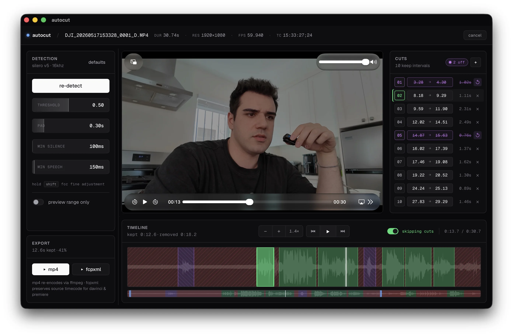

<div dir="rtl">

<p align="center">
  
</p>

<h1 align="center">AutoCut Studio</h1>

<p align="center">
  <strong>ادیتور ویدیوی دسکتاپ و محلی با حذف خودکار سکوت، دستیار هوش مصنوعی روی تایم‌لاین، زیرنویس سینک‌شده، ساخت چپتر یوتیوب و لایه‌های ویدیو/عکس شفاف (B-Roll و PiP).</strong><br>
  <a href="README.md">English</a> · <strong>فارسی</strong>
</p>

<p align="center">
  توسعه و ارتقا توسط <a href="https://jahaniwww.com"><strong>علی جهانی (Ali Jahani)</strong></a> ·
  <a href="https://t.me/tarfandoonchannel">کانال تلگرام ترفندون</a> ·
  <a href="https://jahaniwww.com">وبسایت</a>
</p>

---

## ✨ قابلیت‌های این نسخه ارتقایافته

این پروژه بر پایه نسخه اصلی [cobanov/autocut](https://github.com/cobanov/autocut) (ساخته‌شده با Svelte 5، Rust، Tauri 2، مدل محلی Silero V5 و FFmpeg داخلی) توسعه داده شده و امکانات کامل تولید محتوا به آن اضافه شده است:

- **ادیتور هوش مصنوعی روی تایم‌لاین (تب `✦ AI`):** با دستور متنی فارسی یا انگلیسی ویدیو را ادیت کنید (کات تند یوتیوبی، حذف ابتدا و انتها، حذف کلیپ‌های کوتاه، چسباندن فاصله‌ها و دکمه Undo با یک کلیک).
- **ارکستریشن هوشمند مدل‌ها و محافظت از کوتا:** از طریق پل محلی [CLI_to_API](https://github.com/alipyth/CLI_to_API) به ابزارهای CLI روی سیستم شما وصل می‌شود، درخواست‌های صوتی را فقط به مدل‌های پشتیبان صوت می‌فرستد، فاصله امن بین درخواست‌ها را رعایت می‌کند و در صورت محدودیت یا خطا خودکار به مدل بعدی سوئیچ می‌کند.
- **زیرنویس خودکار سینک‌شده + استایل دلخواه (تب `CC/CH`):** صدای کات‌خورده را به تکه‌های سبک تبدیل و ترنسکرایب می‌کند، با تایم‌لاین نهایی سینک می‌کند، امکان ویرایش متنی، خروجی `.SRT` و حک مستقیم روی MP4 را همراه با تنظیم **سایز فونت، ارتفاع از پایین، رنگ و شفافیت پس‌زمینه** (با پیش‌نمایش زنده) می‌دهد.
- **چپترها و سئو یوتیوب با یک کلیک:** ساخت تایم‌لاین زمانی یوتیوب (`00:00 ...`) منطبق با ویدیوی کات‌خورده + پیشنهاد عنوان، دیسکریپشن و تگ.
- **لایه‌های ویدیو و عکس شفاف (تب `LAYERS`):** اضافه کردن B-Roll یا تصویر در تصویر (پشتیبانی کامل از کانال شفافیت `.mov` / `.webm` / `.png`)، جابه‌جایی آزاد با ماوس روی پلیر و پیش‌نمایش زنده.
- **نرمال‌سازی صدای یوتیوب (`-14 LUFS`) و خروجی FCPXML:** خروجی مستقیم MP4 با صدای استاندارد یوتیوب یا خروجی تایم‌لاین برای DaVinci Resolve و Premiere Pro.

---

## ⚡ اجرای سریع فقط با یک دستور

**پیش‌نیازها:** `Git`، `Python 3.10+`، `Node.js 18+` و `Rust (cargo)`.

### ویندوز (PowerShell)
```powershell
powershell -ExecutionPolicy Bypass -File .\start.ps1
```

### مک و لینوکس
```bash
chmod +x start.sh
./start.sh
```

**این دستور به صورت خودکار همه کارها را انجام می‌دهد:**
1. پروژه [CLI_to_API](https://github.com/alipyth/CLI_to_API) را در پوشه `.cli2api` دانلود می‌کند.
2. محیط مجازی پایتون می‌سازد و سرور محلی را روی `http://127.0.0.1:8787/v1` با CORS فعال بالا می‌آورد.
3. پکیج‌های فرانت‌اند را نصب کرده و اپلیکیشن دسکتاپ را اجرا می‌کند (در اولین اجرا باینری‌های `ffmpeg` خودکار دانلود می‌شوند).
4. پس از بستن برنامه، سرور پس‌زمینه را نیز تمیز می‌بندد.

---

## 🙏 قدردانی و منابع (Credits)

- **توسعه‌دهنده این نسخه:** **علی جهانی (Ali Jahani)** — [وبسایت jahaniwww.com](https://jahaniwww.com) · [کانال تلگرام @tarfandoonchannel](https://t.me/tarfandoonchannel) · [گیت‌هاب @alipyth](https://github.com/alipyth)
- **نسخه اصلی:** این پروژه بر پایه [**cobanov/autocut**](https://github.com/cobanov/autocut) اثر **[Mert Cobanov](https://cobanov.dev)** ساخته شده است. هسته تشخیص سکوت (Silero V5)، رابط کاربری تایم‌لاین، سینک چنددوربینه و خروجی FCPXML متعلق به پروژه اصلی است.
- **پل محلی CLI:** برای اتصال ابزارهای خط فرمان محلی به استاندارد OpenAI API از پروژه اوپن‌سورس [**CLI_to_API**](https://github.com/alipyth/CLI_to_API) (تحت لایسنس MIT) استفاده شده است.

</div>
