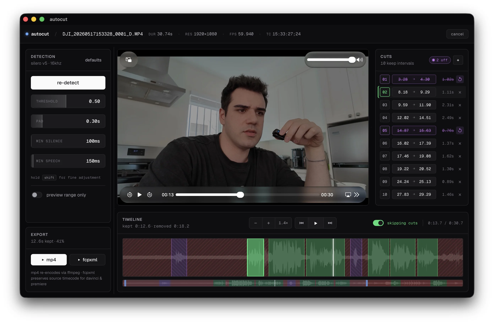

<p align="center">
  
</p>

<h1 align="center">AutoCut Studio</h1>

<p align="center">
  <strong>Local-first desktop video editor with automatic silence removal, AI timeline assistant, synced subtitles, YouTube chapters, and transparent B-Roll / PiP overlays.</strong><br>
  <strong>English</strong> · <a href="README.fa.md">فارسی</a>
</p>

<p align="center">
  Developed &amp; enhanced by <a href="https://jahaniwww.com"><strong>Ali Jahani</strong></a> ·
  <a href="https://t.me/tarfandoonchannel">Telegram Channel</a> ·
  <a href="https://jahaniwww.com">Website</a>
</p>

---

## ✨ What's New in This Enhanced Edition

Built on top of the original [cobanov/autocut](https://github.com/cobanov/autocut) desktop app (Svelte 5 + Rust + Tauri 2 + Silero V5 VAD + bundled FFmpeg), this edition adds a complete creator workflow:

- **AI Timeline Editor (`✦ AI` tab):** Edit your video with natural-language commands (Persian & English) — adjust silence pacing, trim intros/outros, drop short clips, merge gaps, configure export presets, and undo any AI edit in one click.
- **Smart Model Orchestrator & Quota Protection:** Connects to your local AI CLIs through [CLI_to_API](https://github.com/alipyth/CLI_to_API) (`http://localhost:8787/v1`). Automatically routes audio tasks only to audio-capable models, enforces safe request pacing, and switches to the next available model automatically if a rate limit or quota error occurs.
- **Synced Subtitles & Global Styling (`CC/CH` tab):** Cuts spoken segments into lightweight audio chunks, transcribes them via your local CLI bridge, syncs timestamps to the post-cut timeline, lets you edit lines inline, export `.SRT`, or burn subtitles directly onto the exported MP4 with customizable font size, vertical position, color, and background opacity (with live preview).
- **YouTube Chapters & SEO Pack:** One-click generation of post-cut YouTube Chapters (`00:00 ...`), title ideas, description, and tags directly from your synced transcript.
- **Transparent Video & Image Layers (`LAYERS` tab):** Overlay B-Roll videos or images (including transparent `.mov` / `.webm` / `.png` with full alpha channel preservation), drag-and-drop them freely anywhere on the video preview, resize live, and composite directly into the final MP4.
- **YouTube Audio Loudness (`-14 LUFS`):** Optional broadcast/YouTube loudness normalization on MP4 export, plus lossless multi-track **FCPXML** export for DaVinci Resolve and Premiere Pro.

---

## ⚡ One-Command Quick Start

**Requirements:** Git, Python 3.10+, Node.js 18+, Rust (`cargo`), and at least one logged-in local AI CLI (for AI/subtitle features).

### Windows (PowerShell)
```powershell
powershell -ExecutionPolicy Bypass -File .\start.ps1
```

### macOS / Linux
```bash
chmod +x start.sh
./start.sh
```

**What the launcher does automatically:**
1. Downloads [CLI_to_API](https://github.com/alipyth/CLI_to_API) into `.cli2api/` on first run.
2. Creates a local Python virtual environment and starts the local OpenAI-compatible bridge at `http://127.0.0.1:8787/v1` with CORS enabled.
3. Installs frontend dependencies (`pnpm install`) and launches the Tauri desktop app (downloading bundled `ffmpeg` / `ffprobe` sidecars automatically on the first build).
4. Cleans up the background bridge when you close the app.

---

## 🧪 Development & Tests

```bash
pnpm install
pnpm run check                                 # Svelte + TypeScript checks
pnpm test                                      # Vitest unit tests (cuts, AI, orchestrator, subtitles)
cd src-tauri && cargo test --lib               # Rust unit tests
```

---

## 🙏 Credits & Attribution

- **Maintainer / Enhanced Edition:** **Ali Jahani** — [jahaniwww.com](https://jahaniwww.com) · [Telegram (@tarfandoonchannel)](https://t.me/tarfandoonchannel) · [GitHub (@alipyth)](https://github.com/alipyth)
- **Original Project:** Based on [**autocut**](https://github.com/cobanov/autocut) by **[Mert Cobanov](https://cobanov.dev)**. All core silence detection (Silero V5 VAD), timeline UI, multi-track timecode sync, and FCPXML/MP4 engine foundations come from the original upstream project.
- **Local CLI Bridge:** Uses [**CLI_to_API**](https://github.com/alipyth/CLI_to_API) (MIT License) to expose local command-line tools as a local OpenAI-compatible endpoint.
